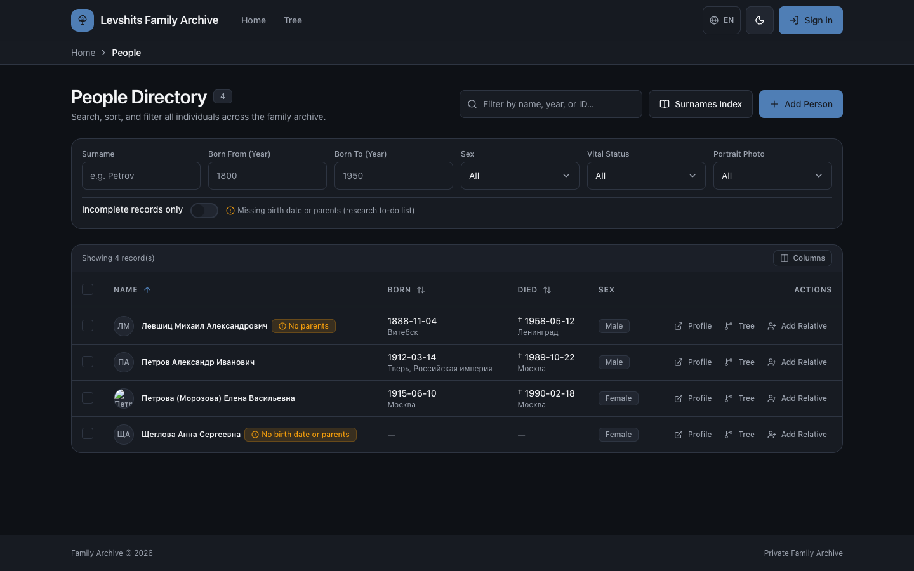
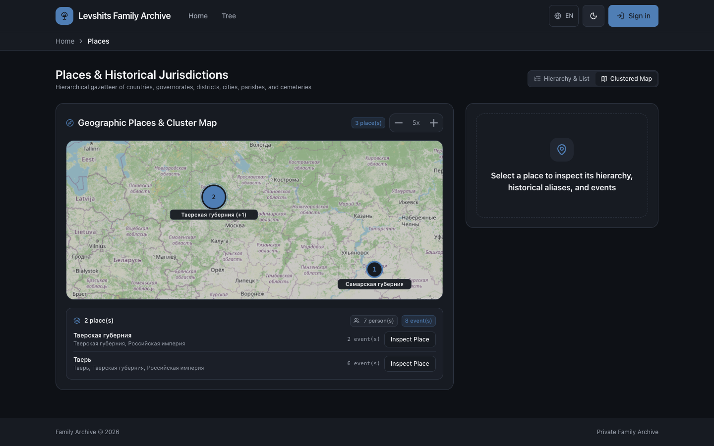
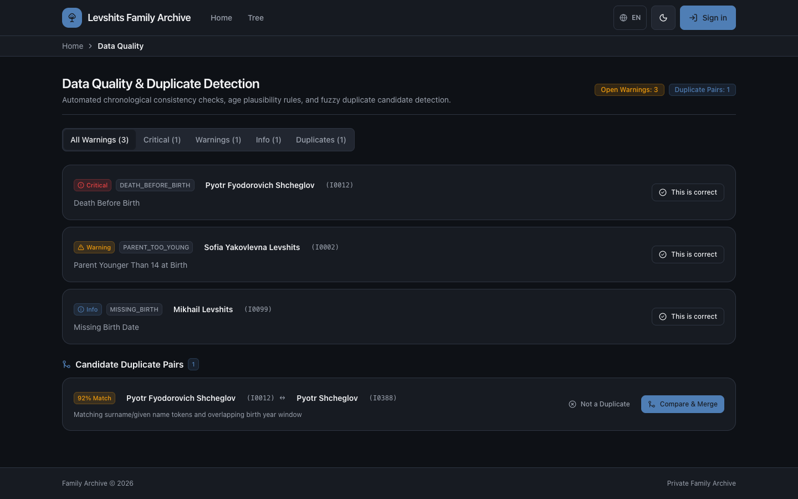
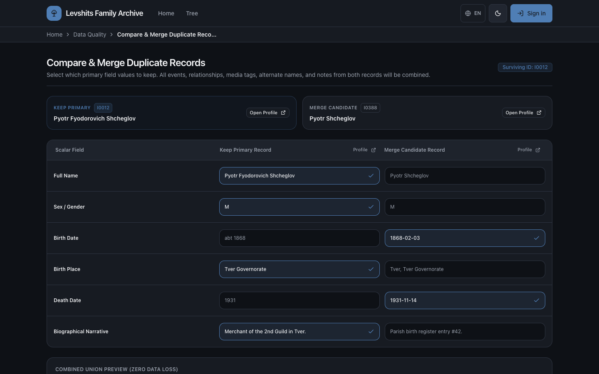
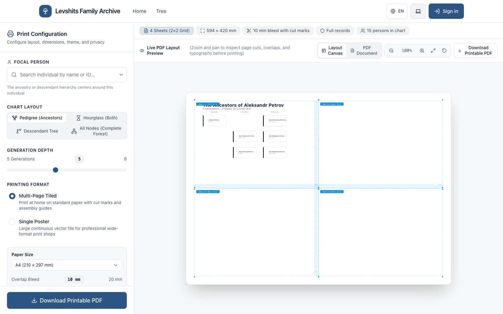
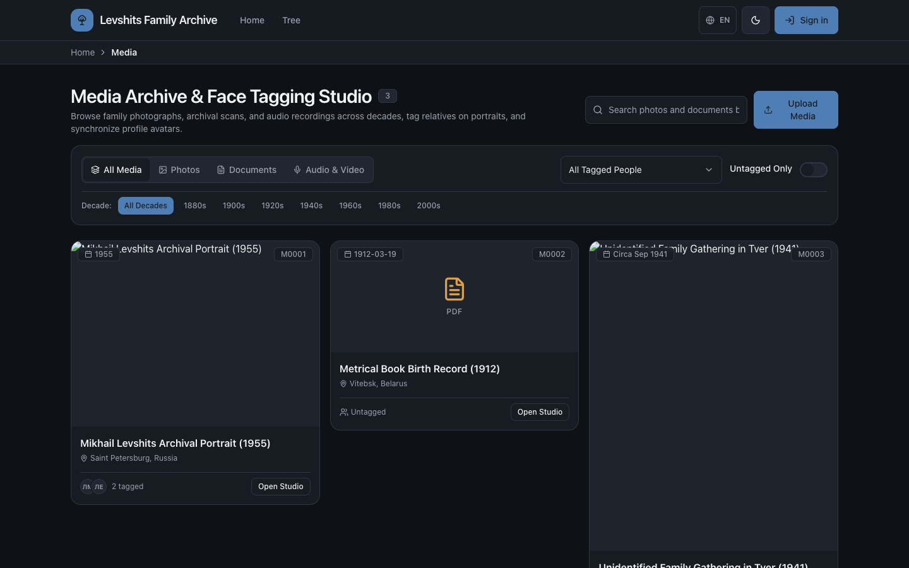
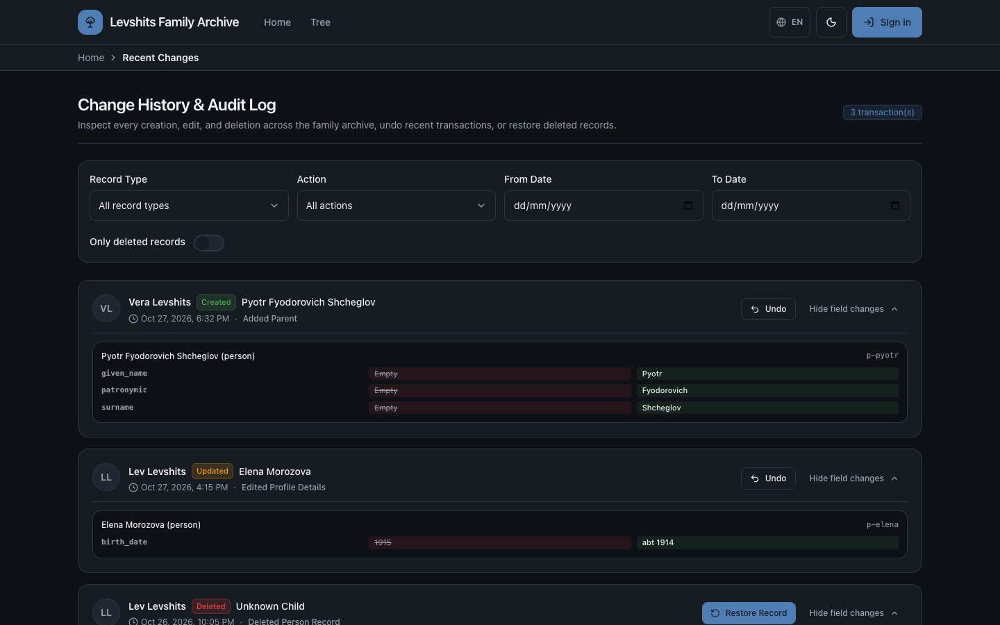
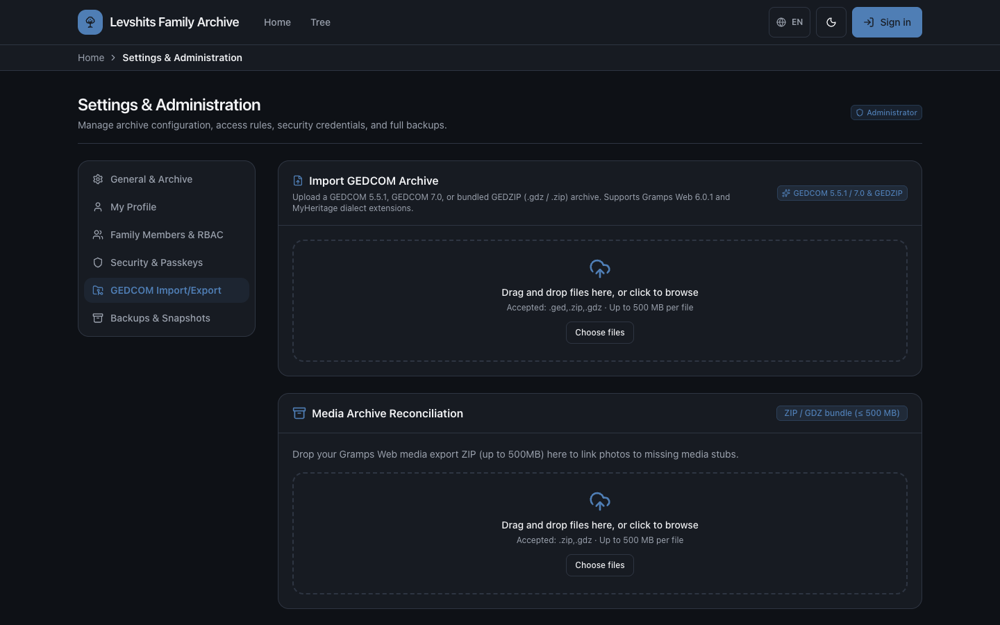
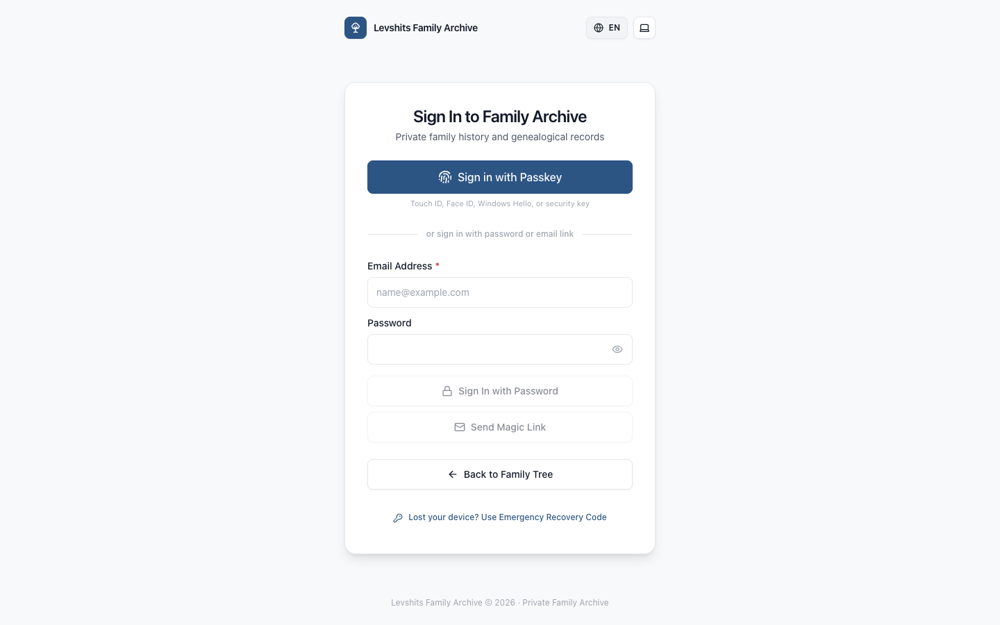

# Family Tree Archive — Self-Hosted Genealogy Platform

A modern, privacy-first, self-hosted web application for building, exploring, and preserving a family tree. Designed around the principle of **1 instance = 1 family archive**, it gives families complete ownership of their genealogical records, photographs, oral histories, and archival documents in a calm, fast, and accessible workspace.

---

## Highlights

- **Private by Default & Living-Person Protection:** Strict 5-tier Role-Based Access Control (`Admin`, `Editor`, `Viewer`, `Public Guest`, `Anonymous`). In optional Public Mode, living relatives (inferred via a 110-year rule when no death record exists) are automatically masked (`"Living"` / `"Живущий"`, initials only) and all sensitive events, notes, and private media are redacted at serialization time.
- **Native Bilingual English & Russian (Day-0 Design):** Full localization (`EN` / `RU`), Slavic naming conventions (given name, patronymic / *отчество*, surname, maiden vs. married surnames), pre-1918 Russian orthography folding, Cyrillic/Latin cross-script search, and bilingual kinship terminology.
- **5 Interactive Tree Visualization Modes:** GPU-accelerated SVG pan/zoom canvas supporting **Hourglass** (compact or collateral-expanded with aunts, uncles, first cousins, siblings, nieces/nephews), **Pedigree**, **Descendants**, **Concentric Fan Chart** (up to 7 generations), and **Complete Forest Graph**, plus a **Multi-Trace Kinship Path Finder**.
- **AI Family Story Intake ("Tell Me About My Family"):** Record voice memories in the browser or paste written family narratives to automatically extract people, vital dates, places, and relationships into a safe **sandbox draft subtree**, answer conversational follow-up questions, and reconcile entities into the live tree. Works with **Google Gemini 3.8 Flash** (single instance-level `GEMINI_API_KEY`) or the built-in **offline deterministic NLP engine**.
- **Protected Model Context Protocol (MCP) Server:** Built-in JSON-RPC 2.0 MCP endpoint (`/api/v1/mcp`) with personal access tokens (`gt_pat_...`), `read` / `read_write` scopes, and privacy-enforced tools for Claude Desktop, Cursor, and custom AI agents.
- **Data Quality, Relationship-Centric Duplicate Detection & Place Hierarchy Auto-Fix:** Automated chronological and age-plausibility checks, duplicate person detection with biological kinship guards, side-by-side record merge, and right-to-left place hierarchy normalization with Haversine spatial matching.
- **GEDCOM 5.5.1 & 7.0 Portability:** Full import/export with GEDZIP (`.gdz` / `.zip`) support, Gramps Web & MyHeritage dialect normalization, external branch merge reconciliation with 1-click snapshot rollback, and bulk media archive reconciliation (up to 500 MB).
- **Printable Vector PDF Studio:** Generate single wide-format posters (`A0`–`A4`) or multi-page tiled home-printable PDFs with configurable overlap bleed (`5–20 mm`), cut marks, assembly grid guides, and embedded Cyrillic fonts.

---

## Screenshots

### People Directory & Cross-Script Search
Search and filter relatives across Cyrillic and Latin scripts, Slavic surname stems, patronymics, vital year ranges, and research completeness flags:



### Places Gazetteer & Clustered Historical Map
Organize historical jurisdictions (`Country / Empire` → `Governorate / Oblast` → `Uyezd / District` → `City / Village / Parish`) and inspect events on an interactive clustered map:



### Data Quality, Chronology Checks & Place Hierarchy Auto-Fix
Detect chronological inversions, age anomalies, relationship-weighted duplicate candidates, and unparsed or orphaned place records with 1-click batch auto-fix and atomic undo:



### Side-by-Side Duplicate Person Merge
Reconcile duplicate records field-by-field while preserving all events, family links, media tags, alternate names, notes, and GID redirect aliases without data loss:



### Printable Vector PDF Studio
Configure focal person, chart layout, generation depth, paper size (`A4`–`A0`), and single-poster vs. multi-page tiled output with live sheet preview and cut marks:



### Media Archive & Face Tagging Studio
Browse photographs, metrical book scans, PDFs, and audio recordings by decade, tag relatives with bounding-box coordinates, and synchronize profile portraits:



### Change History, Field Diffs & 1-Click Atomic Undo
Inspect every creation, update, merge, and import across the archive with field-level before/after diffs and 1-click transaction undo or deleted-record restoration:



### GEDCOM 5.5.1 / 7.0 Import, Export & Media Reconciliation
Import or export standard GEDCOM 5.5.1, GEDCOM 7.0, or GEDZIP archives and reconcile bulk photo ZIP bundles against missing media stubs:



### Passkey-First Authentication (WebAuthn)
Sign in with hardware or platform passkeys (Touch ID, Face ID, Windows Hello, YubiKey), transactional email magic links, password fallback for LAN setups, or emergency recovery codes:



---

## Application Functionality Guide

### 1. Home Dashboard & Onboarding (`/`)
- **Empty-Tree Onboarding:** When starting a fresh archive, the dashboard guides you to either create your own root profile (**Start with yourself**) or import an existing `.ged` / `.gdz` / `.zip` archive (**Import a GEDCOM file**).
- **Family Archive Dashboard:** Displays the archive overview, quick launch into **AI Story Intake** (`/stories/intake`), **Upcoming Anniversaries** (birthdays, weddings, and memorial dates over the next 30 days, filterable by all people or close relatives within 3 kinship steps), **Tree at a Glance** statistics (individuals, generations, photographs, places, open quality warnings), **Latest Photographs**, and **Recent Activity**.

### 2. Interactive Family Tree Canvas (`/tree`)
- **Visualization Modes:**
  - **Hourglass:** Ancestors above and descendants below the focal person, with a toggle between **Compact** (nuclear line) and **Collateral-Expanded** (siblings, aunts/uncles, first cousins, nieces/nephews).
  - **Pedigree:** Ancestor chart expanding upward/rightward by generation.
  - **Descendants:** All descendant branches from the chosen ancestor.
  - **Fan Chart:** Concentric semicircular ancestor chart up to 7 generations with interactive arc selection.
  - **All Nodes (Complete Forest):** Visualizes every connected component and detached branch across the entire archive.
- **Multi-Spouse & Complex Family Topologies:** Supports multiple marriages/unions per person with partitioned child distribution buses and anti-collinear connector routing.
- **Kinship Path Finder:** Select any two individuals in the tree to highlight all biological and marital paths between them and compute their exact English and Russian kinship titles (e.g., *second cousin once removed* / *двоюродный племянник*).

### 3. Person Profiles, Families & Genealogical Dates (`/persons/:id`)
- **Structured Names:** Supports primary name (`given_name`, `patronymic`, `surname`), maiden vs. married surname (`birth_surname`), nicknames, prefixes/suffixes, and unlimited typed alternate names (`birth`, `married`, `aka`, `immigrant`, `orthographic`).
- **Genealogical Date Parser (`GenDate`):** Understands exact dates (`1868-02-03`, `14 NOV 1931`), qualifiers (`abt 1880`, `bef 1905`, `aft 1920`, `cal 1890`, `est 1875`), ranges (`bet 1880 and 1885`), and Russian equivalents (`ок. 1885`, `до 1917`, `после 1945`, `между 1880 и 1885`).
- **Quick-Add Relative Drawer:** Add parents, spouses, siblings, or children directly from a profile or tree node with real-time duplicate candidate alerts.

### 4. AI Family Story Intake (`/stories/intake`)
- **Step 1 — Narrative & Voice Recording:** Type or paste a family story, upload an audio file (`.webm`, `.mp3`, `.wav`, `.m4a`, `.ogg`), or record directly in the browser with live pause/resume and timer controls. Choose who is telling the story (yourself, a specific relative in the tree, or an external narrator).
- **Step 2 — Draft Subtree Review & Clarifications:** Inspect extracted individuals, vital events, places, and family links in an isolated sandbox draft. Answer targeted follow-up questions to resolve ambiguities without touching live tree data.
- **Step 3 — Reconciliation & Atomic Commit:** Review confidence-scored matches (`Link & Enrich` vs. `Create New Person`) and commit the approved draft as a single undoable transaction (`tx_id`).

### 5. Data Quality, Duplicate Merge & Place Hierarchy (`/quality`)
- **Soft Validation Rules:** Flags `DEATH_BEFORE_BIRTH`, `BORN_AFTER_PARENT_DEATH` (`Critical`), `TOO_OLD`, `PARENT_TOO_YOUNG`, `MOTHER_TOO_OLD`, `MARRIED_TOO_YOUNG`, `EVENT_AFTER_DEATH`, `POSSIBLE_DUPLICATE` (`Warning`), and `MISSING_BIRTH`, `UNCONNECTED` (`Info`). Any false positive can be dismissed per record (**Looks Correct**).
- **Relationship-Centric Duplicate Detection:** Scores candidate pairs using parental alignment, spouse overlap, shared children, vital dates/places, and Slavic/phonetic name similarity while strictly disqualifying direct ancestors/descendants, spouses, and confirmed distinct siblings.
- **Automated Place Hierarchy Restructuring:** Decomposes unparsed comma-separated GEDCOM place paths right-to-left, links orphan localities using administrative stem matching and Haversine coordinate containment, normalizes locality prefixes (`г.`, `с.`, `д.`, `уезд`, `губерния`), and consolidates duplicate place nodes.

### 6. Model Context Protocol (MCP) Server (`/api/v1/mcp`)
- Create scoped personal access tokens (`gt_pat_...`) under **Settings → AI & MCP Access** (`/settings?tab=mcp`).
- Connect external MCP clients to `POST /api/v1/mcp` using `Authorization: Bearer <token>`:
  - **Read Tools (`read` scope):** `search_people`, `get_person_profile`, `get_family_Immediate`, `get_kinship_path`, `get_place_hierarchy`, `get_data_quality_summary`.
  - **Write Tools (`read_write` scope):** `stage_story_draft`, `propose_person_update`, `create_person`, `create_vital_event`.

---

## Installation & Deployment Guide

### Option 1: Proxmox VE LXC (1-Click Community Script)

For **Proxmox VE (PVE)** users, launch the authentic Community-Scripts wizard (Debian 12, 2 vCPU, 1 GB RAM, 8 GB disk, unprivileged container):

```bash
bash -c "$(curl -fsSL https://raw.githubusercontent.com/vlevshits/genealogy/main/scripts/proxmox/genealogy.sh)"
```

- **Update anytime:** Run `update` inside the LXC container console.
- **Maintenance-Safe:** 100% immune to Proxmox VE [`clean-lxcs`](https://community-scripts.github.io/ProxmoxVE/scripts?id=clean-lxcs) maintenance cleanup routines (data, PostgreSQL, and configs are strictly isolated from `/tmp`).
- **Community Scripts PR:** Includes upstream-ready files under `scripts/proxmox/` for submission to [community-scripts/ProxmoxVE](https://github.com/community-scripts/ProxmoxVE).

---

### Option 2: Bare-Metal Linux / Standard LXC (Debian & Ubuntu)

On any fresh Debian 11/12 or Ubuntu 22.04/24.04 system, run the unified installer as root:

```bash
curl -fsSL https://raw.githubusercontent.com/vlevshits/genealogy/main/scripts/install.sh | sudo bash
```

- Installs binaries to `/opt/genealogy/`, static web files to `/var/www/genealogy/`, and configures PostgreSQL.
- Binds directly to port 80 (Axum native serving with zero reverse proxy overhead).
- To update in the future, simply run `update` or `sudo /opt/genealogy/scripts/install.sh`.

---

### Option 3: Docker Compose

The production stack runs as **3 containers** (`frontend` Nginx reverse proxy + static SPA, `backend` Rust API + background worker, and `postgres` PostgreSQL 16) on an isolated bridge network with persistent volumes for database, media, and backups.

#### Prerequisites
- **Docker** `24.0+` and **Docker Compose** `v2.20+`

#### Step 1: Clone the Repository & Configure `.env`
```bash
git clone <your-repo-url> genealogy
cd genealogy
cp .env.example .env
```

Edit `.env` and set at least the required database password and your hostname/origin:
```dotenv
# Port exposed on the host machine (default: 8080)
PORT=8080

# Archive title & default interface language (en or ru)
TREE_TITLE="Family Tree Archive"
DEFAULT_LOCALE=en

# Public URL & WebAuthn Relying Party ID
# For local testing on localhost, set APP_ORIGIN=http://localhost:8080 and RP_ID=localhost
APP_ORIGIN=http://localhost:8080
RP_ID=localhost
RP_NAME="Family Tree Archive"

# PostgreSQL credentials (REQUIRED)
POSTGRES_USER=genealogy
POSTGRES_PASSWORD=replace_with_a_strong_password_123!
POSTGRES_DB=genealogy

# Optional: Google Gemini API key for AI Story Intake & Audio Transcription
# Obtain a key from https://aistudio.google.com/app/apikey
# If left empty, the built-in offline deterministic NLP extractor is used automatically.
GEMINI_API_KEY=
GEMINI_MODEL=gemini-3.8-flash
```

#### Step 2: Build and Start the Stack
```bash
docker compose up -d --build
```

Verify all 3 containers are healthy:
```bash
docker compose ps
```

#### Step 3: Complete Initial Admin Setup
1. Open **`http://localhost:8080`** (or your configured `APP_ORIGIN`) in your browser.
2. On first launch, the application automatically opens the **Initial Archive Setup** (`/setup`) wizard.
3. Enter your archive title, administrator name, email, and register a **Passkey** (or set a fallback password for plain-HTTP LAN environments).
4. Store the generated **single-use emergency recovery codes** in a safe place.

---

### Option 2: Local Development (Without Docker)

#### Prerequisites
- **Rust** `1.85+` (`cargo`, `rustfmt`, `clippy`)
- **Node.js** `22+` and `npm`
- **PostgreSQL** `16+` (optional in local dev/test mode — the backend also supports an in-memory/seeded store when `DATABASE_URL` is omitted)

#### 1. Start the Backend (`http://localhost:3000`)
```bash
cd backend
cargo run
```

#### 2. Start the Frontend Dev Server (`http://localhost:5173`)
In a separate terminal:
```bash
cd frontend
npm install
npm run dev
```
Vite proxies `/api` requests to `http://localhost:3000`. Open **`http://localhost:5173`** in your browser.

---

## Configuration Reference (`.env`)

| Variable | Default | Description |
| :--- | :--- | :--- |
| `PORT` | `8080` | Host port mapped to the frontend Nginx reverse proxy container. |
| `TREE_TITLE` | `"Family Tree Archive"` | Archive title displayed in navigation and document headers. |
| `DEFAULT_LOCALE` | `en` | Default UI language (`en` or `ru`). |
| `APP_ORIGIN` | `http://localhost:8080` | Full origin URL used for WebAuthn and CSRF Origin validation. |
| `RP_ID` | `localhost` | WebAuthn Relying Party domain (without protocol or port). |
| `POSTGRES_USER` | `genealogy` | PostgreSQL database user. |
| `POSTGRES_PASSWORD` | *(Required)* | PostgreSQL database password. |
| `POSTGRES_DB` | `genealogy` | PostgreSQL database name. |
| `ENABLE_PUBLIC_ACCESS` | `true` | Allow unauthenticated visitors to view the tree with living people masked. |
| `ENABLE_REGISTRATION` | `false` | `false` = strictly invite-only registration. |
| `LIVING_PERSON_AGE_THRESHOLD` | `110` | Years from birth under which a person without a death record is treated as living. |
| `AUTH_PASSWORD_ENABLED` | `auto` | Password login fallback (`auto`, `true`, or `false`). |
| `MAX_UPLOAD_SIZE_MB` | `100` | Maximum single media upload size in MB (`500` MB for ZIP bundles). |
| `BACKUP_ENABLED` | `true` | Enable scheduled automated archive backups. |
| `BACKUP_CRON` | `"0 3 * * *"` | Cron schedule for automated backups (default: daily at 03:00). |
| `BACKUP_RETENTION_DAYS` | `30` | Days to retain automated backup archives before rotation. |
| `GEMINI_API_KEY` | *(Empty)* | Optional Google AI Studio API key for multimodal audio & narrative extraction. |
| `GEMINI_MODEL` | `gemini-3.8-flash` | Gemini model identifier used when `GEMINI_API_KEY` is configured. |

---

## Administration CLI & Backups

You can trigger full archive backups, restore from a backup bundle, or generate an emergency administrator sign-in link via `genealogy-cli` inside the backend container:

```bash
# Create an on-demand backup archive (.tar.zst / .zip)
docker compose exec backend ./genealogy-cli backup

# Restore the instance from a backup archive
docker compose exec backend ./genealogy-cli restore /app/data/backups/<backup-file>

# Generate a one-time emergency login link for an administrator
docker compose exec backend ./genealogy-cli create-admin-link admin@example.com
```

Backups and snapshots can also be created, downloaded, and restored directly from the web UI under **Settings → Backups & Snapshots** (`/settings?tab=backups`).

---

## Testing & Quality Verification

### Backend (Rust)
```bash
cd backend
cargo fmt --all -- --check
cargo clippy --all-targets -- -D warnings
cargo test
```

### Frontend (React 19 + TypeScript + Vitest + Playwright)
```bash
cd frontend
npm run build        # TypeScript strict typecheck (tsc --noEmit) + Vite production build
npm test             # Vitest unit & component test suite
npm run test:i18n    # EN/RU translation key parity, placeholder & icon-free string checks
npm run test:e2e     # Playwright end-to-end browser test suite
```

---

## Project Structure & Documentation

| Path | Description |
| :--- | :--- |
| [`backend/`](backend/) | Rust (Axum 0.8, Tokio, SQLx 0.8, `utoipa` OpenAPI) API server, GEDCOM engine, PDF layout engine, quality analyzer, and MCP server. |
| [`frontend/`](frontend/) | React 19, TypeScript, Vite 6, and Tailwind CSS v4 web application, design system (`src/components/ui/`), and i18n catalogs (`src/i18n/{en,ru}.json`). |
| [`docs/features/`](docs/features/README.md) | Complete product & technical specifications (`00` through `19`). |
| [`docs/pages/`](docs/pages/) | Per-route UI/UX page specifications (`p01` through `p17`). |
| [`docs/design-system/`](docs/design-system/) | Theme tokens (`theme-and-tokens.md`) and component catalog (`components.md`). |
| [`docs/roadmap.md`](docs/roadmap.md) | Delivery phases and milestone definitions of done. |
| [`docs/memory-bank/`](docs/memory-bank/README.md) | Architectural decisions (ADRs), domain glossary (EN/RU), codebase map, and feature implementation memory. |

