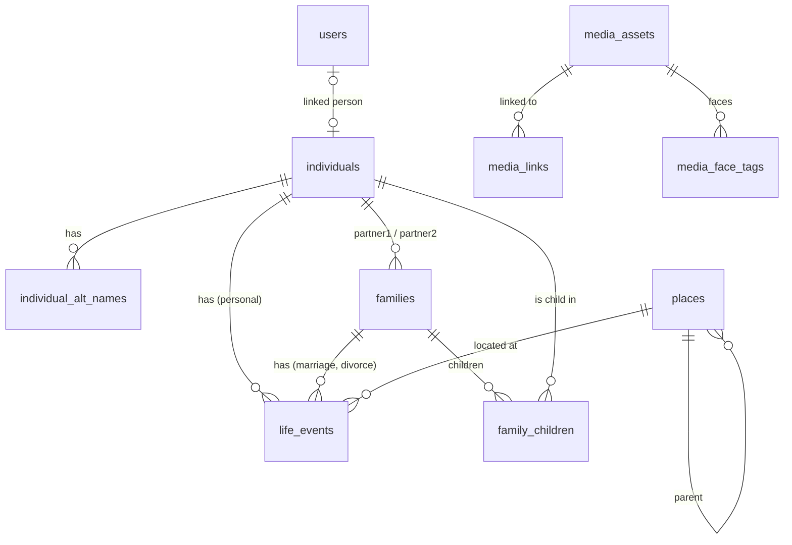

# Feature Specification: Core Genealogy Data Model

## 1. Overview & Objective
This document is the **single source of truth** for the genealogy schema referenced by every other spec (`individuals`, `families`, `life_events`, `places`, `notes`, …).

### Design Principles
1. **Few entities, obvious meaning.** A non-technical relative should be able to understand every field on screen.
2. **GEDCOM-compatible.** Everything stored must round-trip through GEDCOM 5.5.1 / 7.0.
3. **Safe by default.** Unknown living status → treated as living. Deletes are logged and restorable (see [14-change-history-concurrency.md](file:///Users/levshitsvv/Projects/Personal/genealogy/docs/features/14-change-history-concurrency.md)).
4. **Every editable row has `version`** for optimistic concurrency between multiple editors.

### Modeling Rules
- A person has **one primary name** plus optional alternate names (married name, transliteration, alias).
- Each event belongs to **exactly one** person **or** one family.
- Occupation, religion, education, etc. are **event types**.
- Evidence is recorded as a free-text **"Source"** field on each event, plus optional attached scans.

---

## 2. Entity Relationship Overview



Polymorphic tables (`media_links`, `notes`) use `(entity_type, entity_id)` where `entity_type ∈ {individual, family, event, place}`.

---

## 3. Shared Value Types

### 3.1 Human-Readable IDs (`gid`)
- Every top-level record has a short, stable, human-readable ID in addition to its UUID: `I0042` (individual), `F0012` (family), `E0310` (event), `P0007` (place), `M0101` (media).
- Generated from per-prefix Postgres sequences; **preserved from GEDCOM xrefs on import** (`@I42@` → `I42`) when no collision exists.
- Shown discreetly in UI (profile footer, people list column toggle) — useful when relatives discuss records ("look at I0042").

### 3.2 Genealogical Date (`GenDate`)
Stored as `JSONB` + a denormalized integer sort key. Produced by the bilingual date parser ([07](file:///Users/levshitsvv/Projects/Personal/genealogy/docs/features/07-person-family-management.md#22-flexible-genealogy-date-parser-bilingual-en--ru), [00](file:///Users/levshitsvv/Projects/Personal/genealogy/docs/features/00-internationalization-localization.md#24-flexible-date-parser--calendar-support)).

```json
{
  "mod": "about",                       // exact | about | estimated | calculated | before | after | between | from_to
  "start": { "y": 1890, "m": null, "d": null },
  "end": null,                          // only for between / from_to
  "cal": "gregorian",                   // gregorian | julian
  "text": "ок. 1890"                    // original user input, used if parsing failed ("phrase" date)
}
```

- **Partial dates are first-class:** year-only and month-year are valid.
- **Unparseable input** is stored with `mod: "phrase"` and only `text`; it displays verbatim and exports as a GEDCOM date phrase `(…)`.
- **Sort key** (`*_sort INT`): `y*10000 + (m||0)*100 + (d||0)` of `start`, Gregorian-normalized. `before` sorts one day earlier, `after` one day later. Used for timelines, lists, and the living rule.

### 3.3 Enumerations
| Enum | Values |
| :--- | :--- |
| `sex` | `male`, `female`, `other`, `unknown` |
| `family.relationship_type` | `married`, `civil_union`, `partners`, `unknown` — *divorce is an **event**, not a type* |
| `child_relation` | `birth`, `adopted`, `foster`, `step`, `unknown` |
| `person event_type` | `birth`, `baptism`, `death`, `burial`, `cremation`, `residence`, `occupation`, `education`, `military`, `emigration`, `immigration`, `naturalization`, `census`, `religion`, `custom` |
| `family event_type` | `engagement`, `marriage`, `marriage_license`, `divorce`, `residence`, `custom` |
| `place_type` | `country`, `region`, `district`, `city`, `village`, `parish`, `cemetery`, `address`, `other` |

`custom` events carry a free-text `custom_type` label (e.g. *"Раскулачивание"*, *"Evacuation"*).

---

## 4. Schema (PostgreSQL 16)

> Extensions: `pgcrypto` (UUIDs), `pg_trgm` + `unaccent` (search, see [13](file:///Users/levshitsvv/Projects/Personal/genealogy/docs/features/13-search-people-directory.md)).
> Every editable table additionally has: `version INT NOT NULL DEFAULT 1`, `created_at`, `updated_at`, `created_by UUID NULL REFERENCES users(id) ON DELETE SET NULL`, `updated_by …` — omitted below for brevity.

### 4.1 Individuals & Names
```sql
CREATE TABLE individuals (
    id              UUID PRIMARY KEY DEFAULT gen_random_uuid(),
    gid             VARCHAR(20) UNIQUE NOT NULL,
    given_name      VARCHAR(120) NULL,
    patronymic      VARCHAR(120) NULL,          -- Отчество
    surname         VARCHAR(120) NULL,
    birth_surname   VARCHAR(120) NULL,          -- maiden / birth surname
    nickname        VARCHAR(120) NULL,
    name_prefix     VARCHAR(40)  NULL,
    name_suffix     VARCHAR(40)  NULL,
    sex             VARCHAR(10)  NOT NULL DEFAULT 'unknown',
    living_override BOOLEAN NULL,               -- NULL = compute automatically (§5)
    biography       TEXT NULL,                  -- Markdown, shown on profile
    avatar_media_id UUID NULL REFERENCES media_assets(id) ON DELETE SET NULL,
    avatar_crop     JSONB NULL,                 -- {x,y,w,h} normalized 0..1 (set by face tagging or manual crop)
    is_private      BOOLEAN NOT NULL DEFAULT FALSE,
    external_ids    JSONB NOT NULL DEFAULT '{}',-- e.g. {"uid": "CF665D02-7132-46C3-868D-7BF37FD03AC5", "mh_rin": "MH:I10"}
    -- denormalized, maintained by backend on event changes:
    birth_sort      INT NULL,
    death_sort      INT NULL,
    has_death_event BOOLEAN NOT NULL DEFAULT FALSE,
    search_text     TEXT NOT NULL DEFAULT ''    -- normalized + transliterated names (see 13)
);

CREATE TABLE individual_alt_names (
    id            UUID PRIMARY KEY DEFAULT gen_random_uuid(),
    individual_id UUID NOT NULL REFERENCES individuals(id) ON DELETE CASCADE,
    name_type     VARCHAR(20) NOT NULL,         -- married | alias | transliteration | religious | other
    given_name    VARCHAR(120) NULL,
    patronymic    VARCHAR(120) NULL,
    surname       VARCHAR(120) NULL,
    lang          VARCHAR(8) NULL               -- e.g. 'ru', 'en', 'yi', 'pl'
);
```

### 4.2 Families & Children
```sql
CREATE TABLE families (
    id                UUID PRIMARY KEY DEFAULT gen_random_uuid(),
    gid               VARCHAR(20) UNIQUE NOT NULL,
    partner1_id       UUID NULL REFERENCES individuals(id) ON DELETE SET NULL,
    partner2_id       UUID NULL REFERENCES individuals(id) ON DELETE SET NULL,
    relationship_type VARCHAR(20) NOT NULL DEFAULT 'married',
    is_private        BOOLEAN NOT NULL DEFAULT FALSE,
    external_ids      JSONB NOT NULL DEFAULT '{}',-- e.g. {"uid": "65952E5DA9D66F783EC3856809EA9F21", "mh_rin": "MH:F500033"}
    CHECK (partner1_id IS NULL OR partner2_id IS NULL OR partner1_id <> partner2_id)
);

CREATE TABLE family_children (
    family_id       UUID NOT NULL REFERENCES families(id) ON DELETE CASCADE,
    child_id        UUID NOT NULL REFERENCES individuals(id) ON DELETE CASCADE,
    sort_order      INT NOT NULL DEFAULT 0,
    rel_to_partner1 VARCHAR(10) NOT NULL DEFAULT 'birth',
    rel_to_partner2 VARCHAR(10) NOT NULL DEFAULT 'birth',
    PRIMARY KEY (family_id, child_id)
);
```
- Partners are **role-neutral** (`partner1`/`partner2`), supporting same-sex couples. GEDCOM export maps to `HUSB`/`WIFE` by sex (fallback: partner1 → `HUSB`).
- A child may belong to several families (birth family + adoptive family).
- A single parent is a family with one partner.

### 4.3 Life Events
```sql
CREATE TABLE life_events (
    id            UUID PRIMARY KEY DEFAULT gen_random_uuid(),
    gid           VARCHAR(20) UNIQUE NOT NULL,
    individual_id UUID NULL REFERENCES individuals(id) ON DELETE CASCADE,
    family_id     UUID NULL REFERENCES families(id)    ON DELETE CASCADE,
    event_type    VARCHAR(32) NOT NULL,
    custom_type   VARCHAR(80) NULL,
    date          JSONB NULL,                  -- GenDate
    date_sort     INT NULL,
    place_id      UUID NULL REFERENCES places(id) ON DELETE RESTRICT,
    description   TEXT NULL,                   -- e.g. occupation title, military unit, cause of death
    source_text   TEXT NULL,                   -- free text: "Метрическая книга Тверской церкви, 1912, л. 34" / "Grandma Vera's memories"
    is_private    BOOLEAN NOT NULL DEFAULT FALSE,
    CHECK ((individual_id IS NULL) <> (family_id IS NULL))
);
```
- **At most one** `birth` and one `death` per person are treated as *primary* (first by `date_sort`); additional ones are allowed (conflicting records) and shown as alternates.
- **Source (simple):** the event form has one optional *"Source"* text field with autocomplete from previously used values, plus *"Attach scan"* (a regular media asset linked to the event).

### 4.4 Notes
```sql
CREATE TABLE notes (
    id          UUID PRIMARY KEY DEFAULT gen_random_uuid(),
    entity_type VARCHAR(16) NOT NULL,  -- individual | family | event | place | media
    entity_id   UUID NOT NULL,
    body        TEXT NOT NULL,         -- Markdown, sanitized on render
    is_private  BOOLEAN NOT NULL DEFAULT FALSE,
    sort_order  INT NOT NULL DEFAULT 0
);
CREATE INDEX ON notes (entity_type, entity_id);
```
- Free-text notes for stories, research remarks, and transcriptions. Each note has exactly one owner (no shared notes).
- `individuals.biography` remains the single "life story" field; notes are for everything else.
- Private notes show a 🔒 badge and are stripped for Viewers/anonymous ([02 §3.4](file:///Users/levshitsvv/Projects/Personal/genealogy/docs/features/02-rbac-access-control.md#34-private-records--notes)).

### 4.5 Places & Media
Defined in their own specs to keep this file readable:
- `places` → [12-places.md](file:///Users/levshitsvv/Projects/Personal/genealogy/docs/features/12-places.md)
- `media_assets`, `media_links`, `media_face_tags` → [06-media-face-tagging.md](file:///Users/levshitsvv/Projects/Personal/genealogy/docs/features/06-media-face-tagging.md)

### 4.6 System Tables
```sql
-- Server-side sessions (revocable; needed for "Revoke sessions" in admin UI)
CREATE TABLE sessions (
    id            UUID PRIMARY KEY DEFAULT gen_random_uuid(),
    user_id       UUID NOT NULL REFERENCES users(id) ON DELETE CASCADE,
    token_hash    VARCHAR(255) UNIQUE NOT NULL,
    user_agent    TEXT NULL,
    created_at    TIMESTAMPTZ NOT NULL DEFAULT NOW(),
    last_seen_at  TIMESTAMPTZ NOT NULL DEFAULT NOW(),
    expires_at    TIMESTAMPTZ NOT NULL           -- sliding, default 30 days
);

-- Invitations (referenced by 02-rbac and 01-auth)
CREATE TABLE invitations (
    id          UUID PRIMARY KEY DEFAULT gen_random_uuid(),
    token_hash  VARCHAR(255) UNIQUE NOT NULL,
    role        VARCHAR(16) NOT NULL,            -- editor | viewer
    person_id   UUID NULL REFERENCES individuals(id) ON DELETE SET NULL,
    email       VARCHAR(255) NULL,
    invitee_name VARCHAR(120) NULL,
    created_by  UUID NOT NULL REFERENCES users(id) ON DELETE CASCADE,
    expires_at  TIMESTAMPTZ NOT NULL,
    used_at     TIMESTAMPTZ NULL,
    revoked_at  TIMESTAMPTZ NULL
);

-- Instance settings editable from Admin UI (see §7)
CREATE TABLE instance_settings (
    key        VARCHAR(64) PRIMARY KEY,
    value      JSONB NOT NULL,
    updated_at TIMESTAMPTZ NOT NULL DEFAULT NOW(),
    updated_by UUID NULL REFERENCES users(id) ON DELETE SET NULL
);

-- Background jobs (GEDCOM import/export, PDF, backups) — see 17 §5
CREATE TABLE jobs (
    id          UUID PRIMARY KEY DEFAULT gen_random_uuid(),
    kind        VARCHAR(32) NOT NULL,            -- gedcom_import | gedcom_export | pdf | backup
    status      VARCHAR(16) NOT NULL,            -- queued | running | done | failed | cancelled
    progress    SMALLINT NOT NULL DEFAULT 0,
    step_label  TEXT NULL,
    params      JSONB NOT NULL,
    result      JSONB NULL,                      -- e.g. download path, counts, warnings
    error       TEXT NULL,
    created_by  UUID NULL REFERENCES users(id) ON DELETE SET NULL,
    created_at  TIMESTAMPTZ NOT NULL DEFAULT NOW(),
    finished_at TIMESTAMPTZ NULL
);
```
`change_log` and `tree_snapshots` are defined in [14-change-history-concurrency.md](file:///Users/levshitsvv/Projects/Personal/genealogy/docs/features/14-change-history-concurrency.md).

`users` gains preference columns: `locale VARCHAR(8) NULL`, `theme VARCHAR(8) NULL`, `home_person_id UUID NULL REFERENCES individuals(id) ON DELETE SET NULL`, `last_login_at TIMESTAMPTZ NULL`.

### 4.7 Key Indexes
```sql
CREATE INDEX ON family_children (child_id);
CREATE INDEX ON families (partner1_id);
CREATE INDEX ON families (partner2_id);
CREATE INDEX ON life_events (individual_id, date_sort);
CREATE INDEX ON life_events (family_id, date_sort);
CREATE INDEX ON life_events (place_id);
CREATE INDEX ON individuals (surname, given_name);
CREATE INDEX ON individuals (birth_sort);
CREATE INDEX individuals_search_trgm ON individuals USING gin (search_text gin_trgm_ops);
CREATE INDEX ON media_links (entity_type, entity_id);
```

---

## 5. Living Status Rule (Canonical Algorithm)
Used for privacy everywhere (API redaction, GEDCOM export, PDF, public mode). Computed by the backend on read and cached per request; never trusted from the client.

```
is_living(person):
  1. if person.living_override is not NULL → return it
  2. if person has any death / burial / cremation event → DECEASED
  3. if birth year known:
        return (current_year - birth_year) < LIVING_PERSON_AGE_THRESHOLD
  4. estimate birth year from closest relatives (first match wins):
        - child's birth year − 25          (earliest child)
        - partner's birth year             (±0)
        - parent's birth year + 25
        - marriage year − 25
     if estimate exists → apply rule 3 with estimated year
  5. otherwise → LIVING   (unknown = protected)
```
- The profile shows *"Considered living (automatic)"* with an Editor-only toggle to override.
- Recomputation is cheap (in-memory adjacency cache), no stored flag required.

---

## 6. Integrity Rules & Delete Semantics

### 6.1 Hard Constraints (save is rejected)
- A person cannot be their own ancestor (checked via recursive CTE / in-memory graph before linking parent/child).
- A person cannot be both partner and child in the same family.
- `partner1_id ≠ partner2_id`; a child appears at most once per family.
- Event owner is exactly one person or one family; family-only types (`marriage`, `divorce`, `engagement`) cannot be attached to a person.

Soft warnings (death before birth, mother aged 9, etc.) are defined in [15-data-quality-duplicates.md](file:///Users/levshitsvv/Projects/Personal/genealogy/docs/features/15-data-quality-duplicates.md).

### 6.2 Delete Behavior
| Deleting… | Effect | UX |
| :--- | :--- | :--- |
| **Person** | Their events, alt names, notes, face tags, media links are removed. Families: their partner slot set to `NULL`; child links removed. A family left with **no partners and no children** is deleted. `users.person_id` → `NULL`. Media files are **never** deleted. | Confirmation shows impact: *"Deletes 6 events, unlinks 2 families and 4 photos"*. Restorable from History. |
| **Family** | Its events and child links removed. Partners and children remain as persons. | Confirmation lists affected people. |
| **Event** | Its notes and media links removed. | Inline undo toast (5 s). |
| **Place** | **Blocked** while referenced; offer *"Merge into another place"* instead. | See [12](file:///Users/levshitsvv/Projects/Personal/genealogy/docs/features/12-places.md). |
| **Media asset** | Links + face tags removed; file moved to `media/.trash` for 30 days. | Restorable. |

All deletes write a `change_log` entry with the full pre-delete snapshot so they can be restored.

---

## 7. Configuration Precedence (env vs. Admin UI)
Some settings exist in both `.env` and the Admin Settings page (`TREE_TITLE`, `DEFAULT_LOCALE`, `ENABLE_PUBLIC_ACCESS`, `LIVING_PERSON_AGE_THRESHOLD`).

- **Rule:** `.env` provides the **initial default**. Once an admin saves a value in the UI, it is stored in `instance_settings` and **wins**.
- Exception: if `SETTINGS_LOCKED_FROM_ENV=true`, env values always win and the UI fields render read-only with a hint *"Managed by server configuration"*.
- Security-critical values (`APP_ORIGIN`, `RP_ID`, DB credentials, SMTP) are **env-only**.

---

## 8. Definition of Done (DoD)

- [ ] **Migrations:** A single ordered set of SQLx migrations creates every table referenced across all specs; `sqlx migrate run` on an empty DB succeeds.
- [ ] **GenDate Round-Trip:** All date modifiers, partial dates, Julian dates, and phrases survive DB → API → UI → GEDCOM → DB unchanged.
- [ ] **Stable IDs:** `gid` values are unique, preserved from GEDCOM xrefs where possible, and never reused after deletion.
- [ ] **Cycle Protection:** Linking a descendant as a parent is rejected with a clear localized error.
- [ ] **Living Rule:** Unit tests cover all five branches of the living algorithm, including the "unknown → living" default.
- [ ] **Safe Deletes:** Deleting a person shows an impact summary and can be fully restored from History, including family links.
- [ ] **Optimistic Locking:** Every editable table has `version`; stale updates return `409 Conflict` (see 14).
- [ ] **Settings Precedence:** UI-saved settings override env defaults unless `SETTINGS_LOCKED_FROM_ENV=true`.
