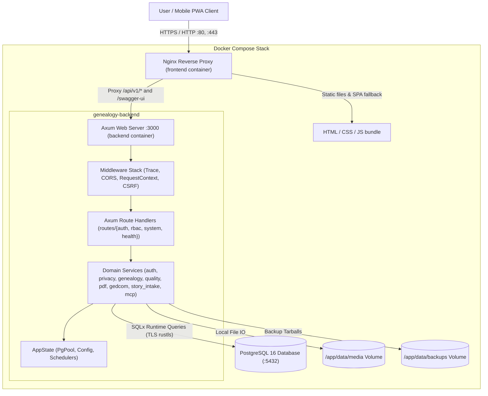
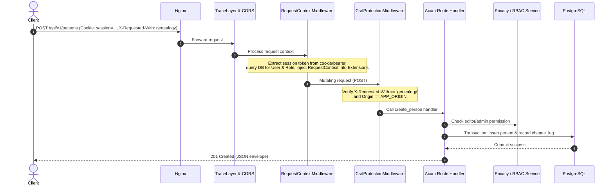

# System Architecture

## 1. High-Level System Architecture

Genealogy is a self-hosted family tree system designed for single-instance, private family deployment. It runs as three containerized services via Docker Compose:



---

## 2. Backend Architecture

### 2.1 Layering & Separation of Concerns

1. **HTTP / Routing Layer (`backend/src/routes/`):**
   - Thin Axum adapters (`routes/mod.rs`, `routes/auth.rs`, `routes/rbac.rs`, `routes/system.rs`, `routes/health.rs`).
   - Responsible for extracting HTTP parameters (JSON payloads, Path, Query, Cookies, `RequestContext`), validating basic formats, and delegating immediately to the service layer.
   - Converts service outcomes or errors into standardized HTTP JSON responses with utoipa OpenAPI attributes.

2. **Domain Service Layer (`backend/src/services/`):**
   - Pure business logic, transactional workflows, and genealogical algorithms:
     - `auth.rs`: Passkeys, magic links, passwords, sessions, lockout counters.
     - `rbac.rs`: Role permissions, policy evaluation, action authorization.
     - `privacy.rs`: Living-person detection (`is_living`), field redaction, privacy-404 generation.
     - `genealogy.rs`: Tree traversal, pedigree, descendants, hourglass, multi-trace kinship path finding.
     - `quality.rs`: Data validation, duplicate detection, automated place hierarchy fixes.
     - `gedcom.rs` & `media_bundle.rs`: GEDCOM 5.5.1 / 7 parser, export, ZIP archive media reconciliation.
     - `pdf/`: Layout computation and vector rendering for single-page and tiled printable trees.
     - `story_intake.rs` & `mcp.rs`: AI story transcription/draft staging, protected MCP server with Personal Access Tokens.
     - `backup.rs`: Database dump, media bundling, tarball restoration.
     - `security.rs`: Sliding-window rate limiters, CSRF validation, sanitization.

3. **Domain Models (`backend/src/models/`):**
   - Strongly-typed domain representations, notably `GenDate` (`gendate.rs`) for partial, approximate, and range dates.

4. **Persistence Layer (PostgreSQL 16 + SQLx):**
   - Direct SQL execution via `sqlx::query` / `sqlx::query_as` runtime parameter binding (no compile-time `query!` macros to allow 100% offline Docker builds).
   - Timestamp-prefixed forward migrations in `backend/migrations/`.

### 2.2 Shared Application State (`AppState`)

Defined in [`backend/src/state.rs`](../../backend/src/state.rs), `AppState` is cloned across all request handlers:
- `db: PgPool` — Connection pool to PostgreSQL.
- `config: Arc<AppConfig>` — Environment and configuration settings.
- `rate_limiter: Arc<RateLimiter>` — In-memory sliding window rate limiter.
- `challenges: Arc<RwLock<HashMap<String, ChallengeEntry>>>` — WebAuthn challenge cache with TTL.

### 2.3 Middleware Stack & Request Lifecycle

Configured in [`backend/src/routes/mod.rs`](../../backend/src/routes/mod.rs):



1. **`TraceLayer` & `CorsLayer`:** Logs request timing and handles CORS headers.
2. **`request_context_middleware`:** Extracts session from `session` HTTP cookie or `Authorization: Bearer` header; resolves user, role, and client IP; injects `RequestContext` into Axum request extensions.
3. **`csrf_protection_middleware` (on `/api/v1`):** For non-safe HTTP methods (`POST`, `PUT`, `PATCH`, `DELETE`), ensures `X-Requested-With: genealogy` is present and matches the expected origin header to prevent CSRF attacks.

### 2.4 Error Handling Model

[`backend/src/error.rs`](../../backend/src/error.rs) defines `AppError`, an enum implemented with `thiserror`. It maps errors into standard HTTP status codes and JSON payloads:

```json
{
  "code": "record_not_found",
  "message": "Human readable message for logs",
  "details": null
}
```
The machine-readable `code` directly mirrors frontend translation keys in `frontend/src/i18n/{en,ru}.json` (e.g. `errors.record_not_found`).

---

## 3. Frontend Architecture

### 3.1 Single Page Application (SPA) Structure

- **Entry Point:** [`frontend/src/main.tsx`](../../frontend/src/main.tsx) initializes the React 19 root, renders [`App.tsx`](../../frontend/src/App.tsx), and loads global CSS with design tokens (`index.css`).
- **Client-Side Routing:** PushState router implemented in `App.tsx` and [`navigation-utils.ts`](../../frontend/src/lib/navigation-utils.ts) with tab/modal URL state management.
- **State & Context Providers:**
  - `ThemeProvider` (`src/lib/theme.tsx`): Manages `light` / `dark` / `system` preference synced to `localStorage` and `html[data-theme]`.
  - `AuthProvider` (`src/lib/auth-context.tsx`): Authenticated user session, current role, home person ID, and initial onboarding state.
  - `I18nProvider` (`src/i18n/index.tsx`): Current language (`en` / `ru`), translation function `t()`, pluralization helper.

### 3.2 Component Layering

```
frontend/src/
├── components/
│   ├── ui/             # Core Design System primitives (Button, TextInput, Modal, Card...)
│   ├── domain/         # Reusable genealogy UI (GenDateInput, PlacePicker, RoleBadge...)
│   ├── tree/           # Canvas, layout nodes, kinship finder, navigation HUD
│   ├── profile/        # Person profile cards, timeline, facts, family groups
│   ├── media/          # Lightbox studio, face tagging canvas, metadata editor
│   ├── quality/        # Data validation issues, merge preview, duplicate pairs
│   ├── print/          # PDF export controls, tile cut-mark previews
│   └── stories/        # AI story audio recorder, text intake, draft review
├── pages/              # Top-level page views (PeoplePage, PlacesPage, TreeCanvas...)
├── lib/
│   ├── tree-layouts/   # Complex layout algorithms (hourglass, all-nodes, fan)
│   ├── kinship.ts      # Relationship calculation and description formatting
│   └── patronymic.ts   # Slavic patronymic derivation rules
└── api/
    ├── client.ts       # Typed API client with standard error mapping
    └── openapi-types.ts# Synchronized schema contracts
```

---

## 4. Cross-Cutting Workflows

### 4.1 Living-Person Privacy Redaction

1. Backend checks `services::privacy::is_living(&person)` based on birth/death events and the 110-year rule.
2. If the user is unauthenticated or has the public viewer role, `services::privacy::redact_person` replaces private attributes with localized placeholders (e.g. "Living", hidden birth dates).
3. If an individual is marked private or living and the request is unauthenticated, attempting direct URL access returns `404 Not Found` (privacy-404) rather than `403 Forbidden` to prevent existence leakage.

### 4.2 Change Log & Concurrency Control

Every mutating genealogy operation (`POST`, `PATCH`, `DELETE` on persons, families, events, places, notes) records an audit entry in the `change_log` table within the same PostgreSQL transaction.
- Tables carry a `version INT NOT NULL DEFAULT 1` column.
- Mutations supply `If-Match: "<version>"` or an equivalent payload version.
- On mismatch, the backend yields a `409 Conflict` (`version_conflict`), which triggers the frontend conflict reconciliation dialog.

_Last curated: 2026-11-04 (memory bank bootstrap)_
