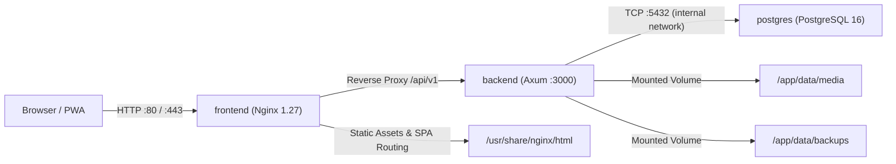

# Project Context

**Genealogy** is a self-hosted, privacy-first family tree web application designed specifically for non-technical relatives across generations. It combines an intuitive bilingual UI (English and Russian) with strict data isolation, genealogical accuracy, and offline-first single-instance deployment.

## 1. Core Principles & Vision

- **1 Instance = 1 Family Tree:** No multi-tenancy, cross-family leaks, or shared cloud databases. The entire tree and its assets belong solely to the hosting family.
- **Private by Default:** Strict living-person protection (automatic redaction for anonymous visitors and viewers).
- **Simple for Relatives:** High usability on desktops, tablets, and phones (PWA); zero genealogical jargon exposed to end-users.
- **Bilingual from Day 0:** Full English (EN) and Russian (RU) parity, native support for Slavic naming customs (patronymics / *отчество*, grammatical gender variants).
- **Accurate Historical Modeling:** Flexible genealogical dates (`GenDate` supporting circa, before/after, date ranges, dual dating), historical jurisdictions/place hierarchies, and rich life events.

See [docs/roadmap.md](../roadmap.md) and [docs/features/README.md](../features/README.md) for detailed product specifications.

---

## 2. Actors & Roles (RBAC)

The application enforces role-based access control ([`02-rbac-access-control`](features/02-rbac-access-control.md)) across four tiers:

| Role | Access Level & Permissions |
| :--- | :--- |
| **Admin** | Full system and data control: user invites, role assignment, backups, restore, tree settings, bulk imports, audit logs, place restructuring. |
| **Editor** | Content management: create, edit, merge people, families, events, places, media, notes, and face tags. |
| **Viewer** | Read-only authenticated member: can view living relatives and private details, browse tree and media, calculate kinships, export PDFs. Cannot mutate data. |
| **Anonymous / Public** | Guest visitor (when public access is enabled): sees only deceased individuals with privacy redaction; no personal notes, private media, or edit controls. When public access is disabled, redirects to login. |

---

## 3. Technology Stack & Versions

### Backend
- **Language / Runtime:** Rust 2021 edition (`rustc 1.82+`)
- **HTTP Framework:** Axum 0.8 with Tokio 1.43 async runtime
- **Database Engine:** PostgreSQL 16 (Alpine) with extensions `pg_trgm`, `unaccent`, `pgcrypto`
- **Data Access:** SQLx 0.8 (runtime queries via `sqlx::query` / `sqlx::query_as`, no compile-time macros, TLS rustls)
- **API Documentation:** OpenAPI 3.1 generated via `utoipa 5.3` and served at `/api/v1/swagger-ui`
- **Serialization:** `serde 1.0`, `serde_json 1.0`
- **Security & Crypto:** `sha2 0.10.9`, `hmac 0.12.1`, `hex 0.4.3`, `base64 0.23.1`
- **Error Handling:** `thiserror 2.0` with standard `AppError` mapping to JSON error envelope

### Frontend
- **Framework:** React 19.0 with TypeScript 5.7+ (strict mode)
- **Build Tool:** Vite 6.2 with `@vitejs/plugin-react 4.3`
- **Styling:** Tailwind CSS v4 via `@tailwindcss/vite 4.0` (CSS-first `@theme` design tokens in `src/index.css`)
- **Icons:** `lucide-react 1.16`
- **Validation & Class Utility:** `zod 3.25`, `clsx 2.1`, `tailwind-merge 3.0` (`cn()`)
- **Testing:** Vitest 4.1 with DOM testing utilities

---

## 4. Deployment Model

The system supports two official deployment approaches:

### 4.1 Native LXC / Bare-Metal (Recommended Production)
Targeted at Debian 11/12 and Ubuntu 22.04/24.04 (x86_64, aarch64) in Proxmox LXC containers or bare-metal servers:
- **Installer / Updater (`scripts/install.sh`):** Single-command script (`curl -fsSL ... | sudo bash` or `sudo /opt/genealogy/scripts/install.sh`) fetching precompiled release archives from GitHub Releases.
- **Service Management:** Systemd service (`deploy/lxc/genealogy.service`) running hardened as system user `genealogy` (`ProtectSystem=full`, `NoNewPrivileges=true`).
- **Web Layer:** Production Nginx reverse proxy (`deploy/lxc/nginx.conf`) handling SPA fallback, cache-control headers, and API proxying; optionally Axum native static file serving via `FRONTEND_STATIC_PATH`.
- **Resource Footprint:** ~30–50MB RAM idle for Axum backend.

### 4.2 Docker Compose (Containerized)
Packaged via [`docker-compose.yml`](../../docker-compose.yml) comprising 3 isolated containers:

- **`frontend` (genealogy/frontend:latest):** Nginx alpine image serving compiled static files, handling client-side SPA routing (`try_files $uri /index.html`), and reverse proxying `/api/v1` and `/media` to the backend container.
- **`backend` (genealogy/backend:latest):** Distroless or Debian-slim container running compiled Rust binary (`genealogy-backend`), listening on port `3000`. Also includes the admin CLI binary (`genealogy-cli`).
- **`postgres` (postgres:16-alpine):** PostgreSQL instance storing relations, change logs, and full-text indexes.

---

## 5. Configuration & Environment

Environment variables are defined in [`.env.example`](../../.env.example) and parsed into `AppConfig` in [`backend/src/config.rs`](../../backend/src/config.rs):

- `APP_ENV`: `development` or `production`
- `DATABASE_URL`: PostgreSQL connection string (`postgres://...`)
- `APP_SECRET`: 64-character secret key used for session signing and token HMAC
- `APP_ORIGIN`: Base URL (e.g. `http://localhost:5173` or `https://family.example.com`) for CSRF verification
- `STORAGE_DIR`: Filesystem directory for uploaded media (`./data/media` or `/app/data/media`)
- `BACKUP_DIR`: Directory for scheduled and manual database archives (`./data/backups`)
- `FRONTEND_STATIC_PATH`: Optional path to pre-built frontend distribution directory for native Axum SPA static file serving
- `GEMINI_API_KEY`, `GEMINI_MODEL`: Optional Google Gemini API key and model identifier for server-side oral story transcription and entity extraction
- `SMTP_*`: Optional configuration for sending magic links and notification emails (falls back to terminal/in-memory logging)

_Last curated: 2026-11-08 (LXC single-script install/update, on-demand release pipeline & release skill)_
